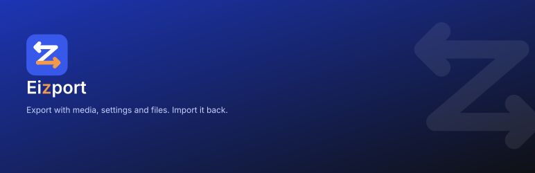

  

  <b>Move your WordPress content. Not your mess.</b> 
  Pick the pages, products or posts you need — or just ask your AI agent. They arrive on the other site with their images, their settings and their homepage.

  <a href="https://eizport.github.io/">Site</a> ·
  <a href="https://eizport.github.io/docs/">Docs</a> ·
  <a href="https://playground.wordpress.net/?blueprint-url=https://raw.githubusercontent.com/eizport/eizport/main/playground/blueprint.json">Try it in Playground</a> ·
  <a href="https://github.com/eizport/eizport/releases/latest">Download</a> ·
  <a href="https://eizport.github.io/donate/">Support</a>

---

### [Eizport](https://github.com/eizport/eizport)

A free, open source WordPress plugin that gives **Tools → Export** a new screen and `.wxrz` bundles:

- **Exactly what you choose** — several content types at once, hand-picked items or filters, and the settings that go with them.
- **One complete file** — content, the media it uses, its settings and each post as readable `.html`, in one `.wxrz` or `.zip`.
- **Imported back with the WordPress Importer** — media from the file, IDs remapped, homepage, shop and checkout set again.
- **WordPress Playground zips** — a whole working site with its theme and plugins, opened in the browser with one link.
- **Built for AI agents** — every action is an ability of the WordPress Abilities API, over MCP, REST, PHP or WP-CLI.

Free under the GPL, with no account, no license key and no “pro” version. [Supported by people like you](https://eizport.github.io/supporters/).
